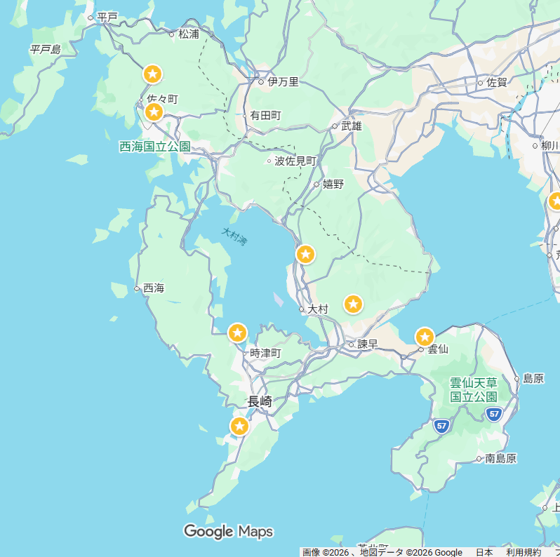

# TheLook-Ecommerce-Analysis-SQL

## Tujuan

- Untuk mengetahui performa penjualan dari TheLook Ecommerce

## Dataset

**Data Source**: TheLook Ecommerce BigQuery

## Pertanyaan

### 1. Berapa jumlah order dengan status Complete?

Jumlah order dengan status Complete yang tercatat adalah 80.000 order

### 2. 

## Key takeways

Ada 80.000 order
